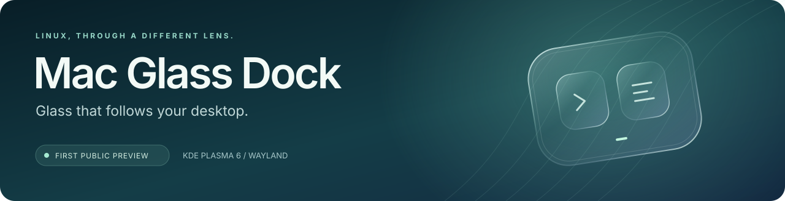
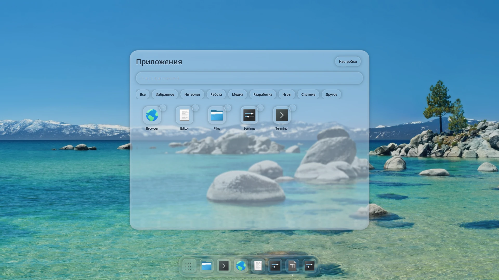
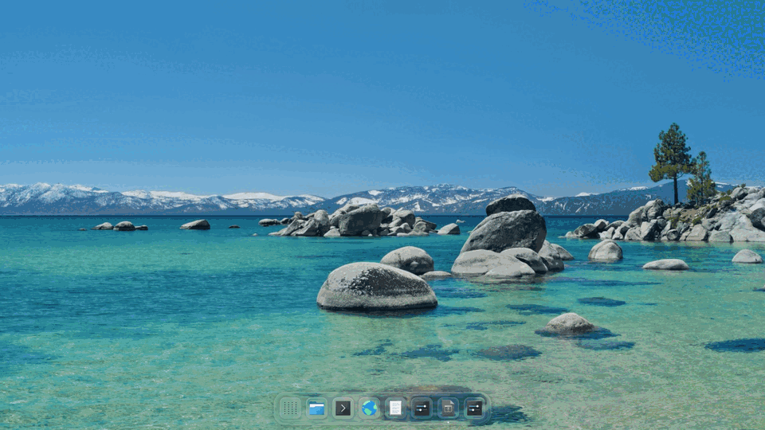
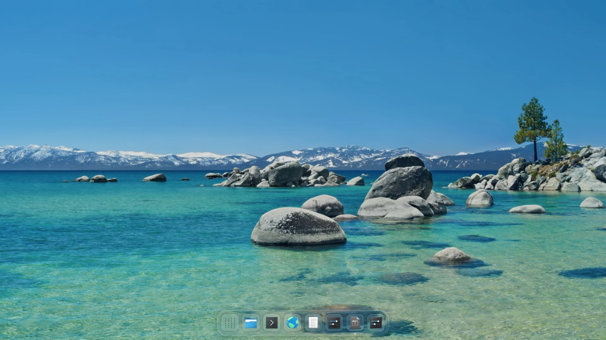
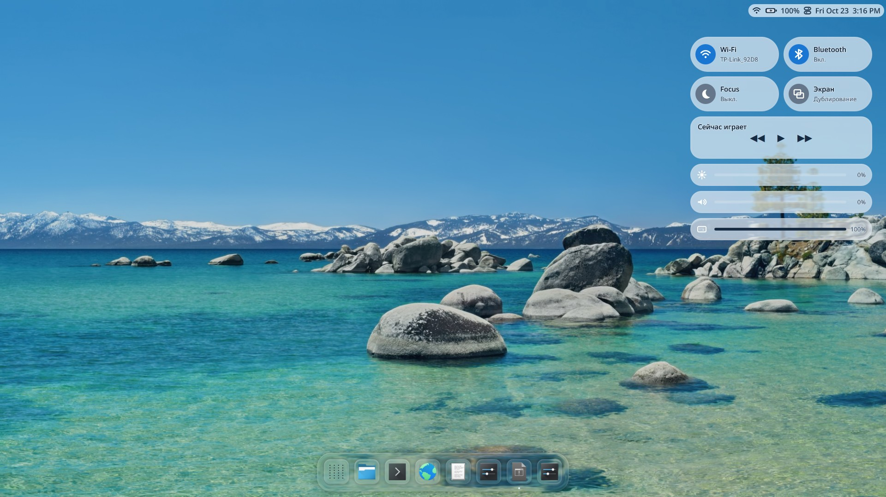
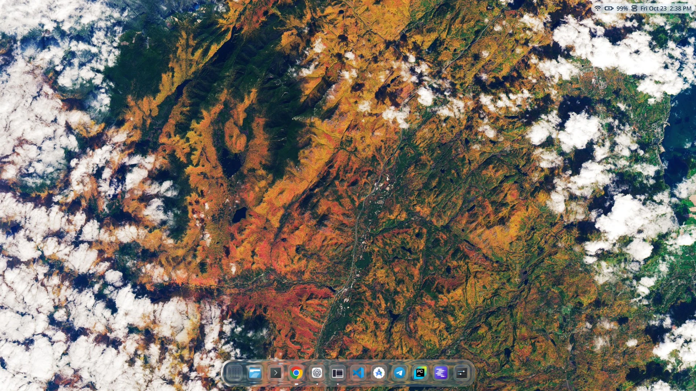
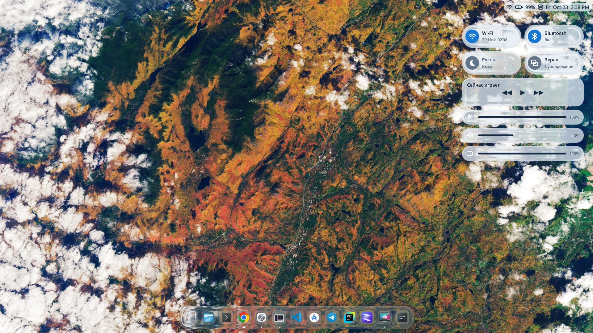
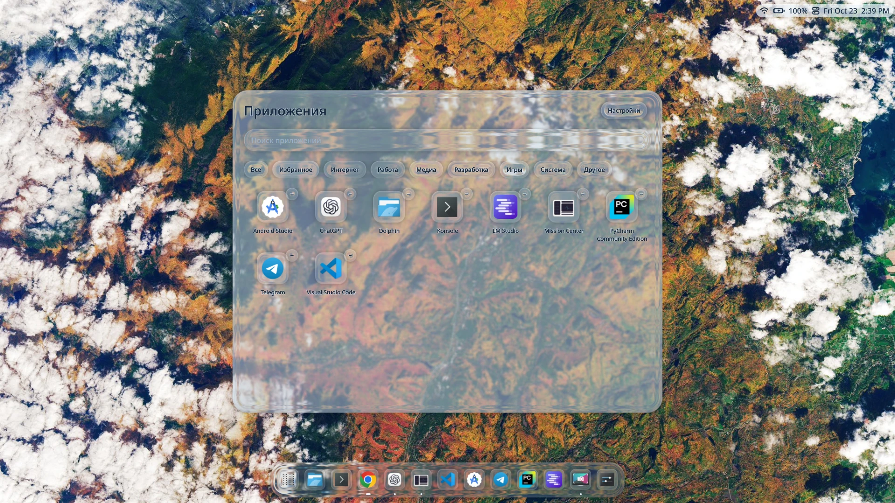

<div align="center">



**Парящий стеклянный Dock для KDE Plasma на Wayland.**<br>
Живое преломление фона · пружинное увеличение иконок · Genie-анимации · стеклянный каталог приложений

[English](README.md) · **Русский** · [Установка](#установка-на-arch-linux) · [Скриншоты](#скриншоты) · [Отзывы](https://github.com/nikitakazancevofficial-ops/mac-glass-dock/issues/new/choose)


[](https://github.com/nikitakazancevofficial-ops/mac-glass-dock/stargazers)



*Настоящий снимок приложения в отдельном сеансе KDE Wayland. Обои Tahoe © Apple; демонстрационный каталог приложений. Интерфейс не сгенерирован.*

**Нравится проект? Поставь ⭐ — так его найдёт больше пользователей Linux. Спасибо!**

</div>

## Зачем я это делаю

Мне хотелось Dock для Linux, который ощущается куском стекла: объёмная подсвеченная кромка, отдельные линзы под иконками и рабочий стол, который преломляется сквозь материал даже во время движения. Mac Glass Dock — моя реализация этой идеи на C++, Qt Quick и собственном эффекте KWin.

Это **первая публичная предварительная версия**; внутренняя версия разработки — **0.4.0**. Проект полностью бесплатен для личного некоммерческого использования. Я буду дорабатывать стекло, анимации, удобство и совместимость. Твои отзывы помогут понять, что улучшать в первую очередь.

## Что уже есть

| Возможность | Как работает |
| :-- | :-- |
| **Живое стекло** | Модуль KWin получает фон под поверхностями Dock и преломляет его: мягкое размытие, подсвеченная кромка, отдельные линзы иконок. |
| **Анимации** | Пружинное увеличение при наведении, подпрыгивание при запуске и Genie-переходы окон к иконкам и обратно. Каталог раскрывается из кнопки сетки. |
| **Каталог приложений** | Поиск установленных XDG-приложений, категории, закрепления. Иконки берутся из системной темы. |
| **Стеклянный центр управления** | Wi-Fi, Bluetooth, звук, яркость экрана и клавиатуры, заряд и часы. Доступность зависит от оборудования и системных служб. |
| **Настройки под себя** | Материал меняется сразу: пресеты, три стиля иконок, автоскрытие, выбор экрана и уменьшение движения. |
| **Интеграция с Plasma** | Необязательные индикаторы окон, действия с окнами, живые миниатюры, автозапуск и обратимая замена панели. |

На ноутбуке автора **регулировка яркости экрана и подсветки клавиатуры действительно работает**. Напиши, как она ведёт себя на твоём устройстве. Focus, медиакнопки и дублирование экрана пока относятся к раннему интерфейсу: полная работа всех видимых плиток не заявляется.

## Установка на Arch Linux

Сначала войди в **KDE Plasma 6 → Wayland**. Самому Dock нужен **Qt 6.8+**. Полное преломление сейчас требует **строго KWin 6.8.0**, **Qt 6.11+** и OpenGL. Для Dock нужен компилятор C++17, для модуля — C++23.

> **Обрати внимание на версию KWin.** Arch обновляется постоянно, поэтому у тебя уже может быть более новая версия. Установщик проверит SDK и на неподдерживаемой версии соберёт базовый Dock с обычным размытием. Он не откатывает систему. Поддержку других версий будем расширять.

### 1. Поставь зависимости

Для уже установленного KDE на Arch / CachyOS:

```bash
sudo pacman -Syu --needed base-devel git cmake ninja python ripgrep pkgconf \
  qt6-base qt6-declarative qt6-shadertools qt6-svg qt6-wayland qt6-tools \
  layer-shell-qt kwindowsystem kservice kio kwayland breeze-icons \
  kconfig kcoreaddons libepoxy libdrm wayland vulkan-headers kpipewire
```

Если обновились Qt, Plasma или KWin, **выйди из сеанса и войди снова** перед запуском эффекта: запущенный композитор должен соответствовать библиотекам на диске.

### 2. Скачай и установи

Выбери постоянную папку: запуск и автозапуск будут ссылаться на неё.

```bash
git clone https://github.com/nikitakazancevofficial-ops/mac-glass-dock.git
cd mac-glass-dock
./scripts/install.sh
```

### 3. Запусти

Найди **Mac Glass Dock** в меню приложений или выполни:

```bash
~/.local/bin/mac-glass-dock
```

Готово. Разобраться с командами можно примерно за минуту; загрузка пакетов и сборка могут занять больше времени. По умолчанию сборка идёт в один поток для экономии памяти. Если RAM достаточно: `CMAKE_BUILD_PARALLEL_LEVEL=2 ./scripts/install.sh`.

<details>
<summary><strong>Варианты установки и зависимости центра управления</strong></summary>

```bash
./scripts/install.sh --check   # Проверить команды и SDK, ничего не менять
./scripts/install.sh --basic   # Только Dock с обычным размытием
./scripts/install.sh --glass   # Требовать совместимую версию KWin SDK
```

Установщик создаёт `~/.local/bin/mac-glass-dock`, пункт меню и, при подходящем SDK, пользовательские файлы эффекта. Запуск Dock, автозапуск и перенос панели включаются отдельно. После установки зависимостей sudo не нужен.

Центр управления использует существующие службы: `nmcli` (NetworkManager), `bluetoothctl` (bluez-utils), `wpctl` (WirePlumber), `upower`, `kscreen-doctor` (libkscreen) и KDE PowerDevil. При необходимости установи недостающие инструменты; установка пакета сама по себе не настраивает службу. Яркость и подсветка требуют поддержки оборудования. Живые миниатюры используют QML-модуль диспетчера задач Plasma и KPipeWire; без них доступны названия и иконки окон.

</details>

## Первое знакомство

- **Подведи указатель к нижнему краю**, чтобы показать скрытый Dock.
- **Сетка слева** открывает приложения. Начни печатать для поиска; правая кнопка открывает доступные действия и закрепление.
- **Ползунки справа** открывают настройки. Пресет **«Со скринов»** подойдёт для первого знакомства; затем настрой материал под себя. Параметры оригинальных скриншотов автора: [config/screenshots.ini](config/screenshots.ini).
- Включи **показ запущенных приложений / интеграцию окон** для действий с окнами. Для Genie включи **анимации окон**, когда модуль KWin доступен.
- **Задержи указатель над приложением примерно на две секунды** для выбора окна. Живые миниатюры зависят от Plasma/PipeWire.
- **Статусная область справа сверху** открывает центр управления. **Escape** закрывает всплывающие панели.

Интерфейс приложения сейчас преимущественно русский. **README и формы обратной связи доступны на русском и английском**; полный английский перевод интерфейса запланирован.

## Почему это «настоящее стекло»

Полный эффект работает **внутри композитора KWin**: получает пиксели уже рисуемого фона под нашими поверхностями и локально искажает и размывает их сквозь скруглённые линзы. Изменения рабочего стола видны через стекло, в том числе во время compositor-анимации каталога.

Это **преломление живого фона в реальном времени**. Объём создают кромка, Fresnel-подобные блики и хроматические края. При этом эффект художественный: это не полная физическая симуляция оптики и не реализация Apple.

Без модуля KWin остаются обычное размытие KWin и материал Qt. **Такой режим не даёт того же преломления рабочего стола.** При программном рендеринге часть графики тоже упрощается. [Техническое описание →](docs/REFRACTION.md)

## Как устроены анимации

| Действие | Результат |
| :-- | :-- |
| Наведение | Иконки и их соседи плавно увеличиваются с Gaussian falloff и пружинным сглаживанием. |
| Запуск | Короткое ограниченное подпрыгивание сообщает о запросе запуска. |
| Появление / закрытие / сворачивание / восстановление | При включённой интеграции и модуле KWin сопоставленное окно изгибается к своей иконке или разворачивается из неё: двухфазная Genie-воронка. |
| Каталог приложений | Раскрывается из сетки; compositor-путь сохраняет живое преломление фона в движении. |
| Уменьшение движения / Reduced Motion | Отключает крупные переходы и снижает количество движения. |

На результат влияют сопоставление окна с иконкой, тип окна и сторонние эффекты KWin. Если сопоставления нет, используется упрощённый переход. Скриншоты показывают материал; по ним нельзя оценить плавность или FPS.

## Анимация в работе



*Запись настоящего композитора в отдельном демонстрационном сеансе. Скорость анимации намеренно установлена в 0.45 для наглядности; сжатый GIF не является замером производительности. Фон Tahoe статичный — функции живых обоев в Dock нет.*

## Скриншоты

### Рабочий стол

[](docs/media/tahoe-desktop.webp)

### Центр управления

[](docs/media/tahoe-control-center.jpg)

### Каталог приложений

[](docs/media/tahoe-launcher.webp)

<details>
<summary>Ещё скриншоты с повседневного рабочего стола автора</summary>





</details>

Фон Tahoe принадлежит Apple и показан для демонстрации; [источник обоев](https://512pixels.net/projects/default-mac-wallpapers-in-5k/). Dock не устанавливает его, отдельный файл обоев с проектом не распространяется.

Нажми на изображение, чтобы открыть полный размер. Логотипы приложений и обои принадлежат соответствующим владельцам; тема сторонних иконок и комплект обоев с проектом не поставляются.

## Автозапуск и панель Plasma

**Автозапуск включается по желанию** в настройках Dock либо из папки проекта:

```bash
python3 scripts/desktop-session.py enable-autostart
python3 scripts/desktop-session.py status
```

Помощник ждёт готовности KDE, затем загружает эффект, если установлен полный режим стекла, и запускает Dock. Используются пользовательская запись XDG autostart, скрипт автозапуска KDE и пользовательская systemd-служба. Блокировка предотвращает дублирование. Вручную настраивать эти механизмы не нужно.

**Не перемещай папку проекта и не удаляй `build/mac-glass-dock` при включённом автозапуске.** После переноса повтори установку и включение автозапуска из нового каталога. Если сохранённая сборка исчезнет или завершится при запуске, помощник попробует вернуть исходную панель и отключить свой запуск. При временной неготовности KDE панель возвращается на текущий сеанс, а повторная попытка при следующем входе сохраняется.

Кнопка **«Сделать основным Dock»** переносит существующую нижнюю панель задач влево, сохраняя её виджеты. **«Вернуть панель Plasma»** возвращает её. Установка сама панель не перемещает. Без постоянного автозапуска временная замена отменяется при следующем входе.

```bash
# Отключить будущий автозапуск, оставив текущий Dock открытым:
python3 scripts/desktop-session.py disable-autostart

# Вернуть панель и оформление, отключить автозапуск и закрыть Dock:
./scripts/session.sh --restore-plasma
```

Резервные копии и помощник восстановления: `${XDG_STATE_HOME:-~/.local/state}/mac-glass-dock/`. Необязательное оформление Soft Corners меняет серверные заголовки окон; приложения со своими рамками сохраняют свои кнопки.

## Совместимость и ограничения

| Система | Статус |
| :-- | :-- |
| Ноутбук автора: Arch-based / CachyOS, KDE Wayland, KWin 6.8.0, Qt 6.12 | Среда разработки и проверок; доступен полный путь стекла. |
| Arch Linux + KDE Plasma 6 + Wayland | Первая целевая платформа. Версии библиотек и композитора имеют значение. |
| Другие версии KWin | Можно попробовать базовый Dock; модуль преломления намеренно отклоняет другой ABI. |
| Другие дистрибутивы с KDE Wayland | Пока не проверены. Очень нужны отчёты о системе. |
| GNOME, Hyprland, Sway, X11, Windows, macOS | В этой версии не поддерживаются. |

Несколько мониторов с разным масштабом, hotplug, HDR, разные GPU/драйверы и длительная работа требуют дополнительных проверок. Одинаковый FPS или расход батареи на всех устройствах не обещается. Пока знакомишься с первой версией, сохрани доступ к обычной панели.

## Напиши, как работает у тебя

**Можно на русском или английском.** [Оставить отзыв](https://github.com/nikitakazancevofficial-ops/mac-glass-dock/issues/new/choose), [сообщить об ошибке](https://github.com/nikitakazancevofficial-ops/mac-glass-dock/issues/new?template=bug_report.yml), [попросить поддержку своей системы](https://github.com/nikitakazancevofficial-ops/mac-glass-dock/issues/new?template=compatibility.yml).

Укажи дистрибутив, версии Plasma/KWin/Qt, GPU и драйвер, Wayland и масштаб монитора. Собрать основные сведения поможет команда, которая только читает данные:

```bash
./scripts/system-info.sh
```

Она ничего не отправляет. Проверь вывод перед публикацией, убери личные данные из логов и скриншотов. Пиши и о проблемах, и об успешном запуске: **так появится полезный список совместимых систем**, а я смогу ориентироваться на твоё оборудование.

Хочешь больше такого на Linux — **поставь звёздочку и поделись ссылкой**. Это по желанию; личное использование бесплатно и без звёздочки.

## Что дальше

- Совместимость с другими версиями KWin и более простые пакеты.
- Проверки на разных GPU, мониторах и дистрибутивах.
- Улучшение сопоставления приложений и окон, управления с клавиатуры и производительности.
- Полный английский интерфейс и улучшения доступности.
- Доработка стекла и анимаций.
- **Над файловым менеджером тоже планируется работа.** Это будущая часть проекта, не готовый файловый менеджер в текущей версии. Иконка папки пока открывает установленный системный менеджер.

Проект будет развиваться. Идеи и понятные отчёты об ошибках очень помогут. [Дорожная карта →](docs/ROADMAP.md) · [Как помочь →](CONTRIBUTING.md)

## Обновление, разработка и удаление

Закрой Dock, затем:

```bash
git pull --ff-only
./scripts/install.sh
```

Запусти Dock снова. После обновления KWin сначала перезайди в сеанс и проверь совместимость эффекта.

Для сборки с тестами: `./scripts/build.sh --tests`, затем `ctest --test-dir build --output-on-failure`. У тестов отдельные XDG-каталоги; offscreen-проверки не подтверждают картинку реального композитора. [Заметки для разработки →](docs/DEVELOPMENT.ru.md)

Для удаления сначала выполни `./scripts/session.sh --restore-plasma`, затем `./scripts/refraction.sh disable`, если эффект загружен. После восстановления рабочего стола можно удалить созданные запускатель `~/.local/bin/mac-glass-dock`, запись `${XDG_DATA_HOME:-~/.local/share}/applications/org.macglass.Dock.desktop` и папку проекта. Файлы модуля находятся в `${XDG_DATA_HOME:-~/.local/share}/mac-glass-dock/refraction/`. Сохрани резервные копии до восстановления панели. Системные зависимости нужны и KDE — не удаляй их вслепую.

## Лицензия

**Бесплатно для личного некоммерческого использования. Коммерческое использование запрещено.** Разрешено изучать код, менять для себя и распространять некоммерческие копии с теми же условиями, сохраняя авторство и лицензию. Полные условия: [LICENSE](LICENSE), зависимости: [THIRD_PARTY_NOTICES.md](THIRD_PARTY_NOTICES.md).

Исходники доступны, но из-за ограничения на личное использование это **source-available**, а не open source в смысле OSI. У отдельно устанавливаемых Qt/KDE и других зависимостей сохраняются собственные лицензии. Проект не связан с Apple или KDE.
